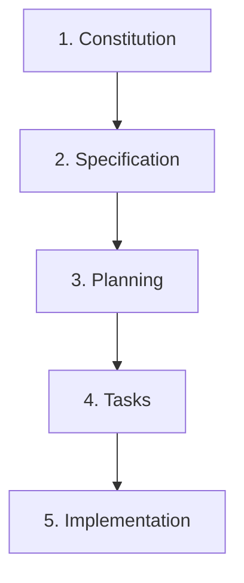

# 🌱 SpecKit Assistant

> **Visual Orchestrator for Spec-Driven Development (SDD)** — Decoupled Hexagonal Architecture, Next.js 15, ReactFlow, and Multi-Agent Orchestration.

---

[](https://github.com/dmux/speckit-assistant)
[](https://opensource.org/licenses/MIT)
[](https://github.com/dmux/speckit-assistant)
[](https://nodejs.org)
[](https://nextjs.org)
[](#contributing)

---

### 🌐 Project Overview

**SpecKit Assistant** is a visual orchestrator for **Spec-Driven Development (SDD)**. It connects your local specification, planning, and task checklists with AI agents (Claude, Gemini, Copilot) through a modern, Vercel-style dashboard. By utilizing **Hexagonal Architecture**, it fully decouples the core domain rules from UI and external runners, ensuring that your local file system remains the single source of truth at all times.

---

## 📖 Table of Contents

1. [Core Concept & SDD Flow](#-core-concept--sdd-flow)
2. [Key Features](#-key-features)
3. [User Interface Screenshots](#-user-interface-screenshots)
4. [Architecture (Hexagonal / Ports & Adapters)](#-architecture-hexagonal--ports--adapters)
5. [Installation & Setup](#-installation--setup)
6. [How to Publish to npmjs](#-how-to-publish-to-npmjs)
7. [CLI Usage](#-cli-usage)
8. [Meeting → Requirements (Zoom)](#-meeting--requirements-zoom)
9. [Workspace Anatomy](#-workspace-anatomy)
10. [Testing & Quality Assurance](#-testing--quality-assurance)
11. [License](#-license)

---

## 🎯 Core Concept & SDD Flow

**Spec-Driven Development (SDD)** is a software engineering methodology that uses structured markdown documents to guide AI agents and human developers sequentially through software lifecycle stages:



1. **Constitution**: Establish project-wide principles, tech stack, and constraints.
2. **Specification**: Document user requirements and features in detail.
3. **Planning**: Outline technical implementation decisions and file modifications.
4. **Tasks**: Break down plans into an actionable checklist of developer-ready tasks.
5. **Implementation**: Execute tasks and generate clean code.

SpecKit Assistant acts as the **Visual Dashboard** and **Command-Line Interface** to run, approve, and track these phases, syncing seamlessly with your local file system.

---

## ✨ Key Features

* 🎨 **Premium UI/UX**: High-fidelity dark and light themes (light by default) styled with a sleek, minimalist Vercel aesthetic.
* 🧭 **Full-Width Sectioned Layout**: Top-level sections separate responsibilities — **Workflow**, **Agents**, **MCP Tools**, and **Extensions** — each using the full width of the screen.
* 🗺️ **Interactive ReactFlow DAG Map**: Visualizes the dependencies and status of every feature's development lifecycle.
* 📡 **Agent Executions View**: A third Workflow view (next to Kanban / DAG) that tracks **every** agent run — phases, review personas, and DevOps agents — with live status, start time, duration, cost, tokens, and exit code, drillable to each run's saved log. Includes an **Obsidian-style force-directed graph** (agent/feature nodes, edges weighted by run frequency) that can be maximized full-screen. Backed by an append-only execution history that survives reloads.
* 🚀 **DevOps Agents (on-demand)**: A profile of operational agents — **Deploy**, post-deploy **Monitor**, and **Troubleshoot** — run on demand from the Executions view, backed by the bundled `spec-kit-devops` extension.
* 🧩 **Extension Manager**: Install and manage spec-kit extensions from the UI — one-click bundled installs (Review Personas, Specification Agents, DevOps Agents), community installs via GitHub ZIP/URL, and a one-click **`specify` CLI installer** (venv-first, from the spec-kit GitHub source — no `git` required).
* 🧑‍⚖️ **Specification & Review Agents**: Spec-phase agents (Product Owner, Architecture, Refinement, Consolidate) wired as `after_specify` hooks, plus a sequential implementation **review gate** (QA, Code Review, Security, Tech Lead).
* 📋 **Drag-and-Drop Kanban Board**: Progress features forward (auto-approving intermediate steps and launching agents) or roll them back (marking downstream files as stale) by simple drag-and-drop.
* 🤖 **Agent Management (YAML)**: Create, edit, and persist multiple CLI agent profiles centrally in `.specify/agents.yaml`; the active agent drives every workflow run. Supports Anthropic's **Claude CLI**, Google's **Gemini CLI**, **GitHub Copilot CLI**, **OpenAI Codex**, or custom CLI wrappers.
* 🔌 **Agnostic MCP Tools**: Define **Model Context Protocol** servers once, assign them per agent, and apply them to each CLI's *native* config — Claude `.mcp.json`, Gemini `~/.gemini/settings.json`, Codex `~/.codex/config.toml` — with safe read-merge-write (and `.bak` backups).
* 💰 **Execution Cost Capture**: Model/CLI-agnostic per-run cost & token usage (parsed when the CLI prints it, otherwise estimated from I/O volume × a pricing table), surfaced in the Human Review Portal.
* 🛡️ **Human Review Portal**: Inspect git diffs, browse the **entire project file tree** with syntax highlighting, toggle markdown preview/raw, and sign off the persona review gate with real cost/duration metrics.
* ✅ **Multi-File Checklists**: Renders a `checklists/` directory of multiple `.md` files via per-file sub-tabs, in addition to a single `checklist.md`.
* 📝 **WYSIWYG Markdown Editor**: Edit specifications or plans with a formatting toolbar (Bold, Italic, Headings, Code Blocks, Tables, Checklists), with support for alternating-row Vercel-style tables.
* 🔄 **Conflict & Change Guard**: A live watcher (`chokidar` + SSE) detects external changes on disk and alerts you in case of editing conflicts.
* 💾 **Persistent State**: Automatically remembers your active workspace inside `~/.speckit-assistant-config.json`.
* 🎙️ **Meeting → Requirements → Features**: A **Requirements** section (and CLI) that imports a Zoom meeting or transcript, turns it into reviewable requirements, and creates Spec Kit features from the accepted ones. Runs through your active agent with the bundled **`spec-kit-meetings`** extension and a Zoom server in MCP Tools — see [Meeting → Requirements](#-meeting--requirements-zoom).

---

## 🖥️ User Interface Screenshots

### Kanban Board View (Interactive state progression)


### ReactFlow DAG Map View (Feature dependency tracking)


---

## 🏛️ Architecture (Hexagonal / Ports & Adapters)

To prevent coupling our core workflows to UI libraries, Next.js, or file system APIs, SpecKit Assistant is built using **Hexagonal Architecture**.

```text
src/
├── domain/                    # Core business rules
│   ├── models/                # Types (Feature, Phase, Task)
│   └── ports/                 # Ports (Interfaces)
│       ├── in/                # Inbound use cases (GetWorkflowState, RunPhase)
│       └── out/               # Outbound SPIs (WorkspaceRepository, AgentRunner)
├── adapters/                  # Infrastructure implementations
│   ├── primary/               # Next.js API controllers, React/ReactFlow UI
│   └── secondary/             # File system sync, Process spawners
```

For a detailed analysis of our architectural decisions, read our **Architecture Decision Records (ADRs)**:

* [ADR 001: Hexagonal Architecture (Ports and Adapters)](docs/adr-001-hexagonal-architecture.md)
* [ADR 002: State Synchronization and Agent Dispatch](docs/adr-002-state-sync-and-agent-dispatch.md)
* [ADR 003: Meeting → Requirements via Zoom MCP and user-provided AI keys](docs/adr-003-meeting-requirements.md)
* [ADR 004: Agent-driven meetings extension (aligning ADR 003 with the agent/extension model)](docs/adr-004-agent-meetings-extension.md)

---

## ⚙️ Installation & Setup

### Prerequisites

* **Node.js**: `v18.0.0` or higher
* **Package Manager**: `pnpm` (preferred), `npm` or `yarn`

### 🚀 Running Instantly via `npx`

You don't need to install or clone anything locally to run the assistant. Simply run it inside your target workspace using `npx`:

```bash
npx speckit-assistant
```
*(This will download the latest release, start the server on port `18080`, and open the Web UI in your browser.)*

### 🛠️ Local Development Quick Start

If you wish to modify the code or contribute to the project:

```bash
# Clone the repository
git clone https://github.com/dmux/speckit-assistant.git
cd speckit-assistant

# Install dependencies using pnpm
pnpm install

# Compile the CLI and Next.js assets
pnpm run build

# Start the Web UI on the default port (18080)
pnpm start
```

---

## 📦 How to Publish to npmjs

To publish `speckit-assistant` under your own account/organization on npm so it can be run via `npx`:

### 1. Authenticate with npm
Log in to your npm registry account (sign up at [npmjs.com](https://www.npmjs.com) if you haven't already):
```bash
npm login
```

### 2. Verify and Configure the Package Name
Open [package.json](file:///Users/guru/work/dmux/speckit-assistant/package.json) and verify:
- `"name"`: Change this if the package name `speckit-assistant` is already taken, or if you want to publish under a scoped organization (e.g. `"@my-org/speckit-assistant"`).
- `"version"`: Bump the version number (e.g. `"0.1.1"`, `"1.0.0"`) every time you publish new changes.

### 3. Build & Publish
Run the publish command. The configured `prepublishOnly` script will automatically compile the Next.js assets and TypeScript files before bundling and uploading the package:

```bash
# For public packages
npm publish

# If using a scoped package (e.g. @my-org/speckit-assistant)
npm publish --access public
```

---

## 💻 CLI Usage

SpecKit Assistant comes with a powerful CLI. When installed globally, you can invoke it using `speckit-assistant` (or via local path `./bin/bin/cli.js`).

### CLI Commands

* **Start the Web Server**:

    ```bash
    speckit-assistant
    ```

    Starts the Next.js server on port `18080` (avoids conflicts on Unix/Windows/macOS) and auto-opens `http://localhost:18080` in your default browser.

* **Check Workflow Status**:

    ```bash
    speckit-assistant status [-w <workspace-path>]
    ```

    Displays a terminal-based overview of your Constitution and feature phase statuses.

* **Approve a Phase**:

    ```bash
    speckit-assistant approve <phase> [feature-name]
    ```

    Marks a phase (e.g. `specification`, `planning`, `tasks`) as approved.

* **Discard/Reset a Phase**:

    ```bash
    speckit-assistant discard <phase> [feature-name]
    ```

    Resets the phase and marks all downstream phases as stale (e.g. discarding `specification` marks `planning`, `tasks`, and `implementation` as stale).

* **Create a New Feature**:

    ```bash
    speckit-assistant create <feature-name>
    ```

    Generates a new directory under `specs/<feature-name>` with template markdown files.

* **Run an Agent Phase**:

    ```bash
    speckit-assistant run <phase> [feature-name] --agent <claude|gemini|copilot> --prompt "refinement details"
    ```

### Command Options

* `-w, --workspace <path>`: Specify the target workspace directory. Defaults to the current directory, but persists the last-used workspace in `~/.speckit-assistant-config.json`.
* `-p, --port <number>`: Override the default port `18080` for the Web UI.
* `--agent <type>`: AI agent execution binary (default: `claude`).
* `--prompt <text>`: Feed specific refinements or custom instructions to the AI agent.

---

## 🎙️ Meeting → Requirements (Zoom)

The **Requirements** section is the front of the SDD flow: it turns a recorded Zoom meeting (or an uploaded transcript) into requirements you can edit, accept/reject, reorder and delete — and then into Spec Kit features.

```
Zoom link ─► Zoom MCP server (transcript + AI summary) ─► your AI provider (structured JSON)
          ─► requirement list (.specify/meetings/<date-topic>/requirements.md) ─► review
          ─► Create features: AI-suggested grouping you review ─► specs/NNN-name/
          ─► Specify phase: your agent CLI runs /speckit.specify with the requirements ─► spec.md
          ─► Workflow: clarify → plan → tasks → implement
```

**Create features** (needs Spec Kit initialized in the workspace and an agent selected under *Agents*): select the accepted requirements, let the AI suggest how to split them into features (or put everything in one), adjust names and membership, then create. Each feature gets a Spec Kit-numbered folder, a committed copy of its requirements (`specs/NNN-name/requirements.md`), and a `spec.md` written by Spec Kit with REQ IDs kept for traceability. Open questions become `[NEEDS CLARIFICATION]` items for the Clarify phase. Editing a requirement that is already part of a feature updates that copy and marks the feature's spec as stale.

**Setup**

Start the app on your project: `npx speckit-assistant -w /path/to/project` (remembered for next time). The project needs Spec Kit (`specify init --here --ai <agent>`, or the one-click installer in **Extensions**).

Pick a **requirements engine** in *Requirements → Settings*:

| | **Agent** (default) | **Direct API** |
|---|---|---|
| Who extracts & groups | Your active agent runs `/speckit.meetings.import` / `/speckit.meetings.group` | This app calls OpenAI / Claude / Gemini |
| Needs | **Extensions → Meeting Requirements**; for Zoom links, **MCP Tools → Add Zoom**, assigned to the agent in **Agents** | An API key in Settings (`OPENAI_API_KEY`, `ANTHROPIC_API_KEY`, `GEMINI_API_KEY` also honored) |
| Speed | About a minute per meeting (an agent run) | Seconds |

In agent mode Claude runs these commands unattended with least privilege: print mode, `--permission-mode dontAsk`, only reading, editing files inside the requirement list's folder, and the Zoom MCP tools. Anything else is refused rather than prompted. If you already had an API key configured, the engine stays on **Direct** until you switch.

**Zoom** (optional — transcript uploads work without it). Zoom's MCP server only accepts registered OAuth apps, so each user creates their own:
- In the [Zoom App Marketplace](https://marketplace.zoom.us/develop/create), create a **General App** with **user-managed** OAuth. If the redirect URL field says *"Custom URLs are only supported in apps that have Meeting SDK feature enabled"*, enable **Features → Embed → Meeting SDK** first.
- Zoom only accepts **public https** redirect URLs (it rejects `localhost` and `127.0.0.1`), so expose the callback through a tunnel, e.g. `ngrok http 18080` (a free static ngrok domain keeps the URL stable) or `cloudflared tunnel --url http://127.0.0.1:18080` (port 3000 for `pnpm dev`). Only `GET /api/integrations/zoom/callback` is served through the tunnel; everything else stays local-only.
- Paste the tunnel's https address into **Public callback URL** in Settings and save, then copy the redirect URL shown there into both **OAuth Redirect URL** and **OAuth Allow List** on the Zoom app.
- Add the read-only scopes `meeting:read:search`, `meeting:read:assets`, `cloud_recording:read:list_user_recordings`, `cloud_recording:read:content`.
- Paste the Client ID / Secret, save, and click **Connect Zoom**. *Test connection* lists the server's tools.
- Agent mode: in **MCP Tools** click **Add Zoom** (adds `https://mcp.zoom.us/mcp/meeting/streamable` with `Authorization: Bearer ${ZOOM_MEETINGS_MCP_ACCESS_TOKEN}`, like Zoom's official plugin) and assign it to your agent. The app injects a fresh token into every agent run.

**CLI**

```bash
speckit-assistant import meeting.vtt --title "Weekly sync"      # or a Zoom link / meeting ID
speckit-assistant requirements                                   # lists; pass a list id to see its requirements
speckit-assistant create-features 2026-10-26-weekly-sync         # AI-suggested grouping; --single for one feature
```

**What can be imported:** past meetings in your Zoom account that had cloud recording with audio transcript, or AI Companion summaries. Recording share links and personal-room links can't be resolved through Zoom — download the transcript (`.vtt`) and upload it instead.

**Recordings (free Zoom plans):** free accounts record to your computer only (`Documents/Zoom/<meeting>/`), so there's nothing for Zoom MCP to read. Upload the recording's `.m4a` (or `.mp4`, `.mp3`, `.wav`) under **File** instead — it's transcribed with speaker labels using your OpenAI key (`gpt-4o-transcribe-diarize`, about $0.006 per minute), then extracted like any transcript. OpenAI accepts up to 25 MB per file; the audio-only `.m4a` is about 0.5 MB per minute. Longer files are split automatically when `ffmpeg` is installed. The `.conf` file in that folder is Zoom's conversion settings, not a recording. From the CLI: `speckit-assistant import audio1234.m4a`.

**Where things are stored**

| What | Where |
| --- | --- |
| API keys, Zoom client secret & tokens | `~/.speckit-assistant/credentials.json` (mode `0600`, never in the workspace, never sent to the browser) |
| Transcript, summary, raw Zoom/LLM output | `.specify/meetings/<list>/` (local) |
| Requirement list (source of truth, hand-editable) | `.specify/meetings/<list>/requirements.md` (local) |
| A feature's source requirements | `specs/NNN-name/requirements.md` (committed with its spec) |

`.specify/meetings/` is added to the workspace `.gitignore` on first import, so meeting data stays local. Each import is listed in **Workflow → Executions** with token usage and an estimated cost.

---

## 📂 Workspace Anatomy

SpecKit Assistant manages markdown files inside your target project workspace. Your workspace directory structure should follow this pattern:

```text
my-project/
├── .mcp.json                   # MCP servers applied to the Claude CLI (generated)
├── .specify/
│   ├── memory/
│   │   └── constitution.md     # Project-wide context & rules
│   ├── agents.yaml             # Persisted CLI agent profiles + active agent
│   ├── mcp.yaml                # Central MCP server definitions
│   ├── personas-config.json    # Review-gate persona configuration
│   ├── spec-agents.yaml        # Specification-phase agent roster
│   ├── devops-agents.yaml      # DevOps agent roster (deploy/monitor/troubleshoot)
│   ├── extensions/             # Installed spec-kit extensions (.registry + each extension)
│   └── .runtime/
│       ├── workflow-state.json # Internal workflow cache (automatically managed)
│       ├── executions.jsonl    # Append-only agent execution history
│       └── logs/               # Captured per-run output logs
└── specs/
    └── 001-user-authentication/
        ├── spec.md             # Feature requirements
        ├── plan.md             # Implementation strategy
        ├── checklist.md        # — or a checklists/ directory of multiple .md files
        ├── tasks.md            # Actionable checklists
        ├── reviews/            # Persona review reports (qa.md, security.md, ...)
        └── devops/             # DevOps agent reports (deploy.md, monitor.md, ...)
```

---

## 🧪 Testing & Quality Assurance

SpecKit Assistant maintains a high bar for reliability and code health:

* **Vitest** for fast, concurrent unit and integration testing.
* **100% Mocked File Systems** in unit tests to prevent disk pollution.
* **Isolated temporary workspaces** for E2E tests, avoiding workspace write conflicts.

We boast **99.44% statement coverage** across our domain rules, API routers, process dispatchers, and repository adapters:

```bash
# Run unit and integration tests
pnpm run test
```

### Coverage Report Details

```text
 ✓ src/domain/services/WorkflowService.test.ts (22 tests)
 ✓ src/domain/services/CostMeter.test.ts (9 tests)
 ✓ src/domain/services/mcpTranslate.test.ts (6 tests)
 ✓ src/adapters/secondary/fs/FSWorkspaceRepository.test.ts (8 tests)
 ✓ src/adapters/secondary/fs/FSMcpConfig.test.ts (4 tests)
 ✓ src/components/HumanReviewModal.test.tsx (12 tests)

 Test Files  13 passed (13)
      Tests  108 passed (108)
```

---

## 📄 License

This project is licensed under the MIT License. See [LICENSE](LICENSE) for details.
